# AZ-104 \| Resource Management — Lab 03a: Resource Groups, Move e Resource Locks

    

> Laboratório prático de **administração de recursos no Azure**: criação de Resource Groups, **movimentação de uma VM Windows 11 em execução** entre grupos sem derrubar a conexão RDP, e **testes reais de Resource Locks** (`Delete` e `Read-only`), incluindo herança, impacto em operações e limpeza final para zerar custos. Documento escrito para que **qualquer pessoa — hoje ou no futuro — consiga entender o que foi feito, por que foi feito e o que foi aprendido**.

|  |  |
| :---- | :---- |
| **Certificação relacionada** | Microsoft Certified: Azure Administrator Associate (**AZ-104**) |
| **Domínio do exame** | *Manage Azure identities and governance* e *Deploy and manage Azure compute resources* |
| **Laboratório** | Lab 03a — Gerenciamento de Resource Groups, Movimentação de Recursos e Resource Locks |
| **Autor** | Fernando — [@FerTerminador17](https://github.com/FerTerminador17) |
| **Ambiente** | Portal do Azure, Conexão de Área de Trabalho Remota (RDP) |
| **Data de execução** | Novembro/2026 |

---

## Sumário

1. [Resumo executivo](#1-resumo-executivo)  
2. [Conceitos usados (leia primeiro se for iniciante)](#2-conceitos-usados-leia-primeiro-se-for-iniciante)  
3. [Ambiente e recursos do laboratório](#3-ambiente-e-recursos-do-laboratório)  
4. [Arquitetura e fluxo do laboratório](#4-arquitetura-e-fluxo-do-laboratório)  
5. [Pré-requisitos](#5-pré-requisitos)  
6. [Passo a passo detalhado com evidências](#6-passo-a-passo-detalhado-com-evidências)  
   - [Tarefa 1 — Resource Groups e provisionamento da VM](#tarefa-1--criação-de-resource-groups-e-provisionamento-da-vm)  
   - [Tarefa 2 — Movimentação de recursos (Move)](#tarefa-2--movimentação-de-recursos-entre-resource-groups-move)  
   - [Tarefa 3 — Governança, herança e testes de Resource Locks](#tarefa-3--governança-herança-e-testes-práticos-de-resource-locks)  
   - [Tarefa 4 — Limpeza e desalocação (Cleanup & FinOps)](#tarefa-4--limpeza-e-desalocação-cleanup--finops)  
7. [Tabela comparativa: Lock Delete vs Lock Read-only](#7-tabela-comparativa-lock-delete-vs-lock-read-only)  
8. [Percepções técnicas e lições aprendidas](#8-percepções-técnicas-e-lições-aprendidas)  
9. [Problemas comuns e solução de problemas](#9-problemas-comuns-e-solução-de-problemas)  
10. [Boas práticas](#10-boas-práticas)  
11. [Competências demonstradas](#11-competências-demonstradas)  
12. [Próximos passos (Automação & IaC)](#12-próximos-passos-automação--iac)  
13. [Glossário](#13-glossário)  
14. [Estrutura do repositório](#14-estrutura-do-repositório)

---

## 1\. Resumo executivo

**Cenário:** a empresa fictícia **Slytech** precisa reorganizar recursos entre Resource Groups sem interromper serviços e quer **proteger recursos críticos** contra exclusão ou alteração acidental.

**O que foi feito:**

| Tarefa | Entrega | Evidências |
| :---- | :---- | :---- |
| **1** | Criação de `rg-origem` e `rg-destino` em East US e deploy de uma VM Windows 11 com RDP validado | `01`, `02`, `03` |
| **2** | Movimentação da VM e de seus 4 recursos dependentes para `rg-destino`, **sem derrubar a sessão RDP**, mantendo a VNet no grupo de origem | `04`, `05`, `06` |
| **3** | Locks `Delete` e `Read-only` aplicados em diferentes escopos e testados contra *delete*, *move*, *stop da VM* e *listagem de chaves do Storage* | `07` a `16` |
| **4** | Remoção do lock, desligamento/desalocação da VM e exclusão dos Resource Groups para zerar custos | `17`, `18` |

**Principais conclusões:**

- Mover recursos entre Resource Groups altera só os **metadados de agrupamento** no ARM; a VM continua rodando.  
- Lock **`Delete`** impede exclusão, mas **permitiu a movimentação** observada neste lab.  
- Lock **`Read-only`** bloqueia **qualquer operação de escrita**: mover, ligar/desligar a VM e até **listar as Access Keys** do Storage.

---

## 2\. Conceitos usados (leia primeiro se for iniciante)

### 2.1 Hierarquia de escopos no Azure

```
Tenant (Microsoft Entra ID)
└── Subscription ......... Azure subscription 1
    └── Resource Group ... rg-origem | rg-destino
        └── Resource ..... VM, disco, NIC, IP público, NSG, VNet, Storage Account
```

Locks, permissões (RBAC) e políticas aplicados em um nível são **herdados** pelos níveis abaixo.

### 2.2 Resource Group (RG)

Contêiner lógico que agrupa recursos com o mesmo ciclo de vida. Ao **excluir** um RG, **todos** os recursos dentro dele são excluídos. O RG tem uma localização (para guardar seus metadados), mas **os recursos dentro dele podem estar em outras regiões**.

### 2.3 Azure Resource Manager (ARM)

Camada que recebe todas as requisições de gerenciamento (portal, CLI, PowerShell, APIs). Separa dois planos:

- **Plano de controle (management plane):** criar, alterar, mover, excluir recursos — passa pelo ARM.  
- **Plano de dados (data plane):** usar o recurso em si (conexão RDP à VM, ler/gravar blobs) — não passa pelo ARM.

### 2.4 Move de recursos

Operação que **troca o RG (ou a assinatura)** de um recurso. Não recria nem migra dados; atualiza o agrupamento lógico. Antes de mover, o Azure executa uma **validação** (*Validation status: Succeeded*).

### 2.5 Resource Locks

Proteções aplicadas a assinatura, RG ou recurso individual. Dois tipos:

| Tipo no portal | Nome na API | O que impede |
| :---- | :---- | :---- |
| **Delete** | `CanNotDelete` | Exclusão (alterações ainda são permitidas) |
| **Read-only** | `ReadOnly` | Qualquer escrita (`PUT`/`POST`/`PATCH`/`DELETE`) — o recurso fica efetivamente somente leitura |

Locks são **herdados** pelos recursos filhos e valem **para todos os usuários, inclusive Owners**. Para mudar o recurso, é preciso antes remover o lock (exige permissão `Microsoft.Authorization/locks/*`, presente em *Owner* e *User Access Administrator*).

### 2.6 FinOps (custos)

Máquinas virtuais cobram computação enquanto estão **alocadas**. **Parar pelo sistema operacional não basta**: é preciso chegar ao estado **Stopped (deallocated)**. Excluir o RG remove tudo e zera o custo.

---

## 3\. Ambiente e recursos do laboratório

| Item | Valor |
| :---- | :---- |
| **Assinatura** | `Azure subscription 1` |
| **Subscription ID** | `f31085f2-3632-409d-83b3-e37a8f1d9e8a` |
| **Região** | East US (`eastus`) |
| **Resource Groups** | `rg-origem` e `rg-destino` |
| **Máquina virtual** | `vm-lab-move` — Windows 11 Pro, geração V2, x64, tamanho `Standard D2nlds v6` (2 vCPUs, 4 GiB RAM) |
| **Disco do SO** | `vm-lab-move_OsDisk_1_39cfc63bb5194ec98113ad77cac44f50` |
| **Interface de rede (NIC)** | `vm-lab-move231` |
| **IP público** | `vm-lab-move-ip` (`20.39.63.122`, usado na conexão RDP, porta 3389\) |
| **Network Security Group** | `vm-lab-move-nsg` |
| **Rede virtual** | `vnet-eastus-1` (sub-rede `snet-eastus-1`) |
| **Storage Account** | `storageslylablocks` |
| **Usuário administrador da VM** | `Admin.sly` |

> **Nota de segurança:** todos os recursos foram **excluídos no final do laboratório** (Tarefa 4), então o IP público e o usuário acima **não existem mais**. Nunca publique senhas, chaves de acesso, *connection strings* ou tokens.

---

## 4\. Arquitetura e fluxo do laboratório

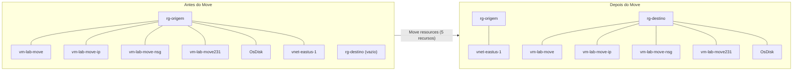

&nbsp;

**Ordem lógica:** criar RGs → criar VM → validar RDP → mover → aplicar locks e testar → remover locks → limpar.

---

## 5\. Pré-requisitos

- Conta Azure com permissão **Owner** (ou equivalente) na assinatura.  
- Cota de vCPU disponível em East US para o tamanho escolhido.  
- Cliente de **Conexão de Área de Trabalho Remota** (RDP) — nativo no Windows.  
- Navegador atualizado para usar o Portal do Azure.

---

## 6\. Passo a passo detalhado com evidências

## Tarefa 1 — Criação de Resource Groups e provisionamento da VM

### Etapa 1 — Criar `rg-origem` e provisionar a VM `vm-lab-move`

**Passos no portal:**

1. **Resource groups** → **Create** → assinatura `Azure subscription 1`, nome `rg-origem`, região **East US**.  
2. Repetir para `rg-destino`.  
3. **Virtual machines** → **Create** → RG `rg-origem`, nome `vm-lab-move`, região East US, imagem **Windows 11 Pro**, tamanho **Standard D2nlds v6**, definir usuário e senha de administrador e liberar a porta **RDP (3389)**.  
4. Aguardar a conclusão do deployment.

**Resultado:** no `rg-origem` aparecem 6 recursos: a VM, o IP público, o NSG, a NIC, o disco do SO e a `vnet-eastus-1`, com **2 deployments succeeded**.

**Evidência:** `images/01-rg-origem-vm-criada.png`

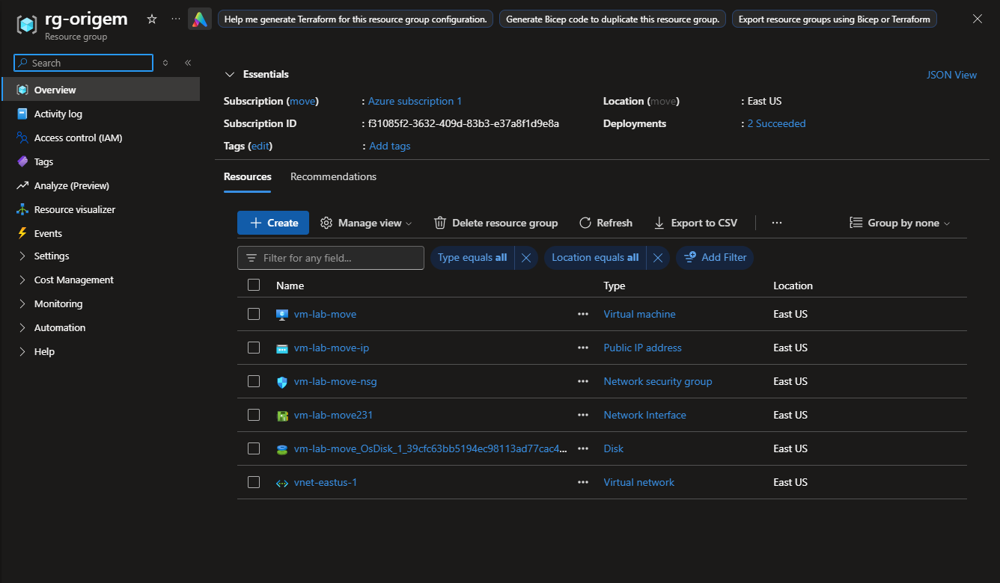

> **Por que a VM gera vários recursos?** No Azure, uma VM é composta por **disco \+ NIC \+ IP público \+ NSG \+ rede virtual**. Todos aparecem como recursos independentes.

### Etapa 2 — Confirmar que o `rg-destino` está vazio

O `rg-destino` foi criado na mesma região e mostra **No deployments** e **No resources match your filters**. Ele será o destino do Move.

**Evidência:** `images/02-rg-destino-vazio.png`

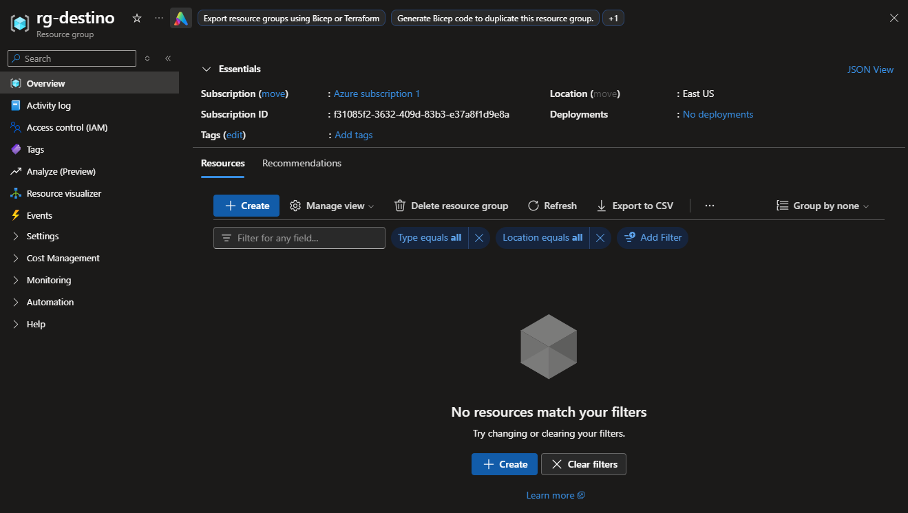

### Etapa 3 — Validar a conexão RDP e o estado da VM

Na VM, **Overview**: `Status: Running`, `Resource group: rg-origem`, `Location: East US`, **Windows 11 Pro**, `VM generation: V2`, `Agent status: Ready`, tamanho `Standard D2nlds v6`, 2 vCPUs, 4 GiB RAM. Em seguida, foi feita a conexão via **Connect → RDP**, abrindo o desktop do Windows com o usuário `Admin.sly`.

**Por que isso importa:** essa sessão RDP será usada como **prova de continuidade** durante o Move (Etapa 5).

**Evidência:** `images/03-vm-rodando-rdp-windows11.png`

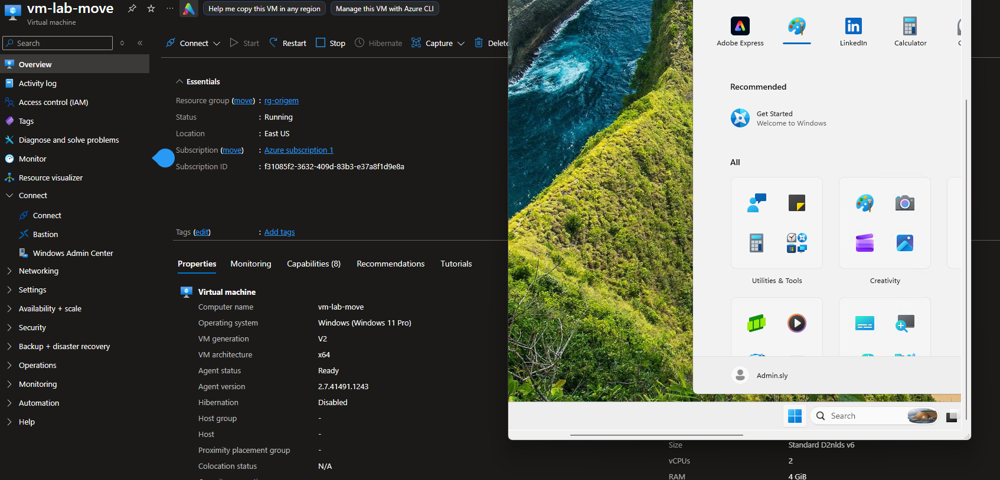

---

## Tarefa 2 — Movimentação de recursos entre Resource Groups (Move)

### Etapa 4 — Selecionar e validar os recursos a mover

**Caminho no portal:** `rg-origem` → marcar os recursos da VM → **Move → Move to another resource group**. O assistente tem 3 passos: **1\) Source \+ target**, **2\) Resources to move**, **3\) Review**.

**Recursos selecionados (5):** `vm-lab-move`, `vm-lab-move-ip`, `vm-lab-move-nsg`, `vm-lab-move_OsDisk_1_...` e `vm-lab-move231`. Todos aparecem com **Validation status: Succeeded**.

**Decisão de projeto:** a `vnet-eastus-1` foi **mantida de propósito no `rg-origem`**, para provar que a rede virtual e a NIC podem ficar em Resource Groups diferentes.

**Evidência:** `images/04-move-validacao-recursos.png`

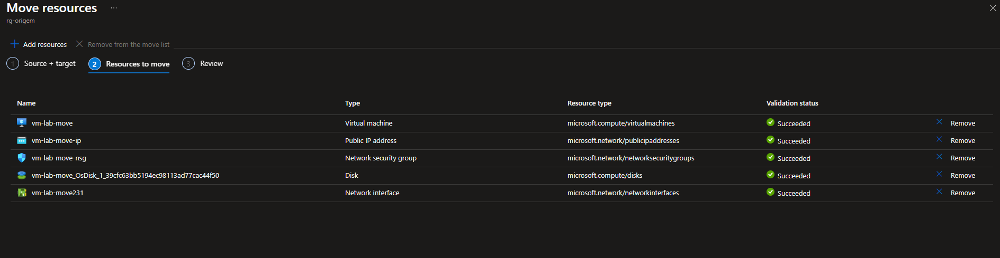

### Etapa 5 — Executar o Move com a VM ativa

Ao confirmar, a notificação mostra **Moving resources — Running**: *"Moving 5 resources from resource group 'rg-origem' ... to resource group 'rg-destino'"*. A **sessão RDP continuou aberta** (conexão `20.39.63.122:3389`, usuário `Admin.sly`), **sem queda**.

**Evidência:** `images/05-move-em-andamento-vm-ativa.png`

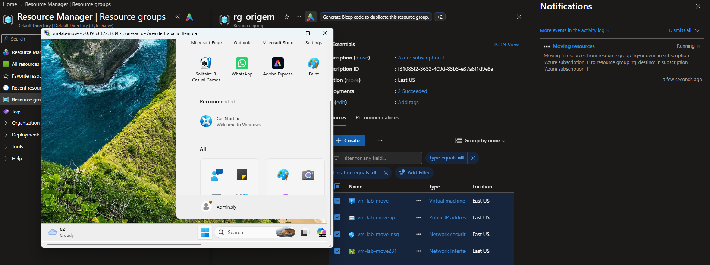

### Etapa 6 — Confirmar a conclusão no `rg-destino`

A notificação muda para **Moving resources complete**: *"Successfully moved 5 resources from resource group 'rg-origem' to 'rg-destino'"*. No `rg-destino` aparecem `vm-lab-move`, `vm-lab-move-ip`, `vm-lab-move-nsg`, `vm-lab-move231` e o disco (**Showing 5 of 5**).

**Evidência:** `images/06-rg-destino-recursos-movidos.png`

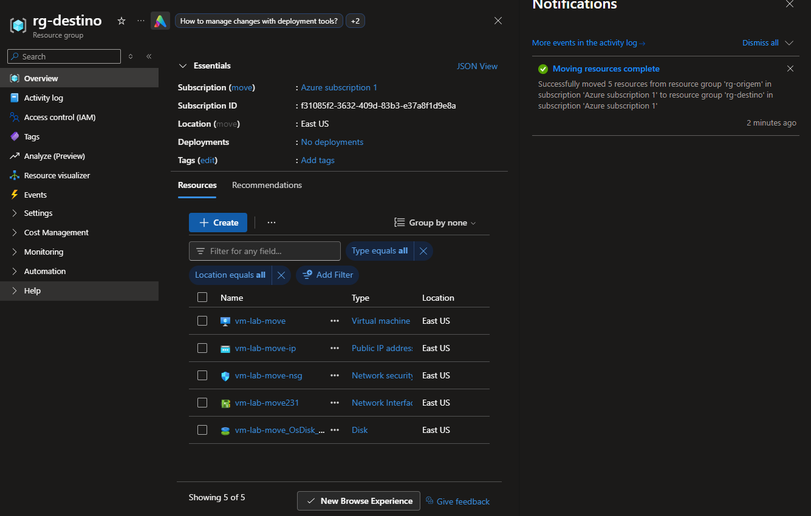

---

## Tarefa 3 — Governança, herança e testes práticos de Resource Locks

### Etapa 7 — Criar o lock `Delete` no `rg-origem`

**Caminho:** `rg-origem` → **Settings → Locks → Add**.

| Campo | Valor |
| :---- | :---- |
| Lock name | `Delete` |
| Lock type | **Delete** |
| Notes | `Teste` |

**Evidência:** `images/07-rg-origem-lock-delete-config.png`

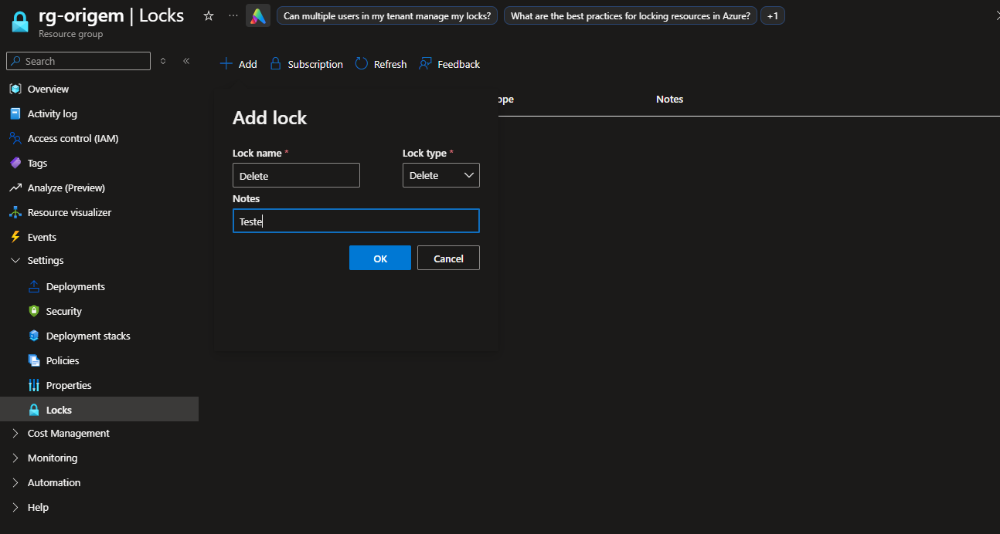

### Etapa 8 — Criar a Storage Account e comprovar a herança do lock

Foi criada a Storage Account `storageslylablocks` no `rg-origem`. No recurso, em **Locks**, o lock `Delete` aparece **herdado do RG**: os botões **Edit/Delete** ficam desabilitados e surge o aviso ***"Parent resource locks can't be edited here"***.

**Conclusão:** o lock **não precisa ser criado em cada recurso**; novos recursos criados no escopo já nascem protegidos.

**Evidência:** `images/08-storage-heranca-lock-rg-origem.png`

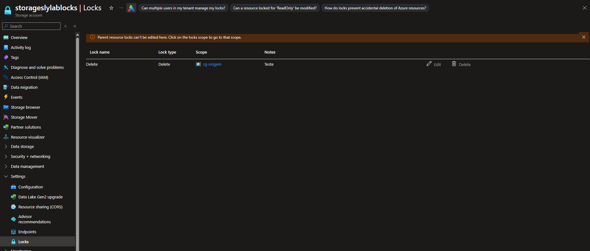

### Etapa 9 — Testar a exclusão (deve ser bloqueada)

Ao tentar excluir `storageslylablocks`, o portal mostra o botão **Delete desabilitado** e o aviso de bloqueio herdado. O lock `Delete` cumpre o papel: **protege contra exclusão acidental**.

**Evidência:** `images/09-teste-exclusao-bloqueada-lock.png`

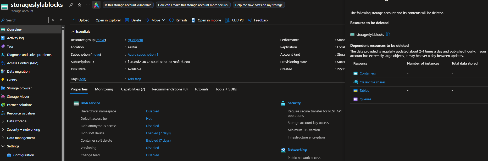

### Etapa 10 — Mover a Storage Account sob lock `Delete`

A movimentação de `storageslylablocks` de `rg-origem` para `rg-destino` **foi concluída com sucesso**, mesmo com o lock `Delete` ativo. Após o Move, o recurso **deixa de herdar** o lock do grupo antigo (passa a herdar o do novo escopo).

> **Observação:** esse é o comportamento **observado neste laboratório**. Como o Azure pode ter regras específicas por tipo de recurso, consulte a documentação oficial antes de depender disso em produção.

**Evidência:** `images/10-move-storage-com-lock-delete.png`

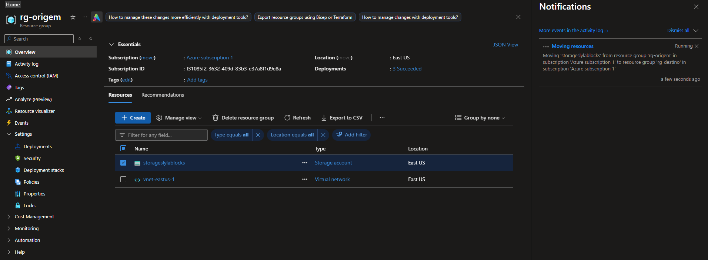

### Etapa 11 — Trocar o lock do `rg-origem` de `Delete` para `Read-only`

No `rg-origem`, o lock foi alterado para **Read-only**, para testar um bloqueio mais restritivo.

**Evidência:** `images/11-rg-origem-lock-readonly-config.png`

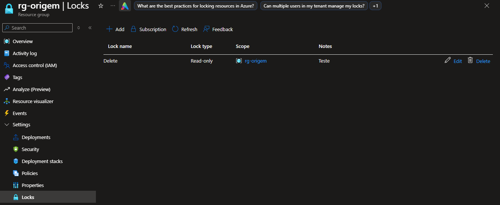

### Etapa 12 — Tentar mover a `vnet-eastus-1` (lock `Read-only` na ORIGEM)

A tentativa de mover a `vnet-eastus-1` para `rg-destino` foi **barrada imediatamente** com **`Code: ScopeLocked`**, porque o escopo de **origem** tem lock `Read-only`.

**Evidência:** `images/12-teste-move-bloqueado-readonly.png`

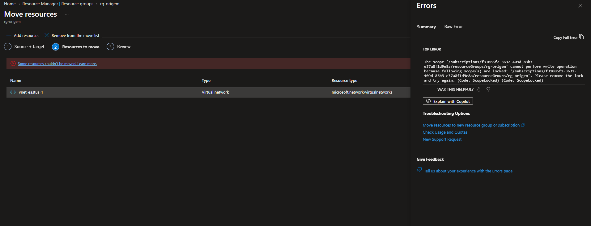

### Etapa 13 — Aplicar lock `Read-only` no `rg-destino`

No `rg-destino` foi criado um lock **Read-only** (`Lock type: Read-only`, nota `Teste`). Como a VM, NIC, IP, NSG, disco e Storage estão agora neste RG, **todos herdam** o bloqueio.

**Evidência:** `images/13-rg-destino-lock-readonly.png`

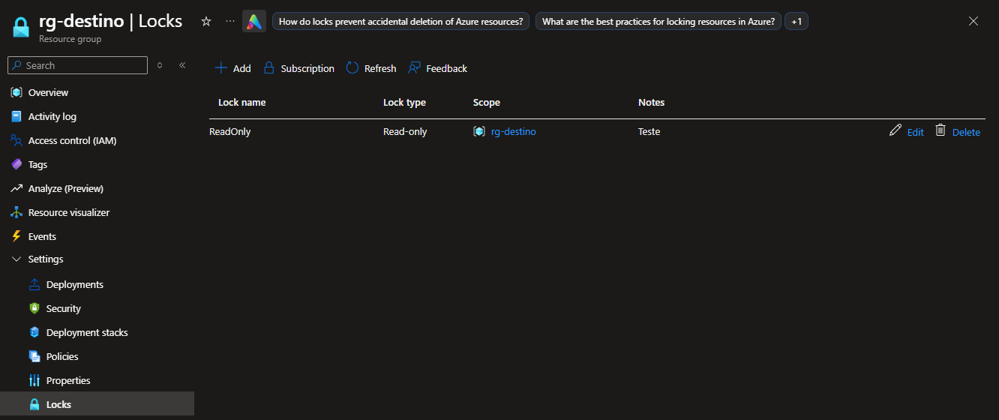

### Etapa 14 — Tentar parar a VM (bloqueado)

Ao tentar **desligar/reiniciar** a `vm-lab-move`, o portal retorna **`Failed to stop virtual machine`** com **`ScopeLocked`**. Parar a VM é uma operação de **escrita** (altera o estado de energia), por isso o `Read-only` bloqueia.

**Evidência:** `images/14-teste-vm-stop-bloqueado-readonly.png`

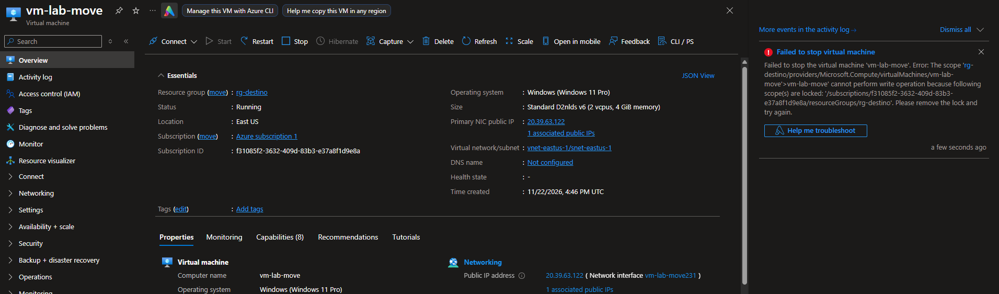

### Etapa 15 — Tentar ver as Access Keys do Storage (bloqueado)

Ao abrir **Access keys** de `storageslylablocks`, ocorre **`ScopeLocked` / Error code `409`**: *"Cannot access the data plane because of a read lock on the resource or its parent"*.

**Por quê?** Listar as chaves usa a ação `listKeys`, que no ARM é uma requisição **`POST`**. Como o `Read-only` bloqueia escritas, ele **também bloqueia essa leitura sensível**.

**Evidência:** `images/15-storage-access-keys-bloqueado-readonly.png`

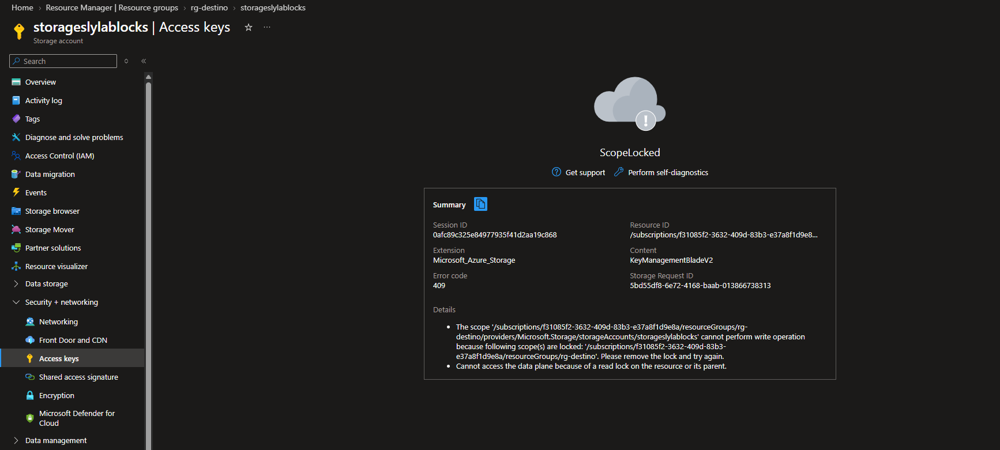

### Etapa 16 — Mover para um destino com lock `Read-only` (origem livre)

Com o `rg-origem` **sem lock**, a `vnet-eastus-1` foi movida para o `rg-destino` (**com** lock `Read-only`). O resultado foi **`Code: ResourceMovePolicyValidationFailed` / `Code: ScopeLocked`**.

**Diferença-chave em relação à Etapa 12:** aqui a falha vem da **validação profunda** do Move (o destino está travado), e levou cerca de **40 segundos a 1 minuto**.

**Evidência:** `images/16-teste-move-bloqueado-destino-readonly.png`

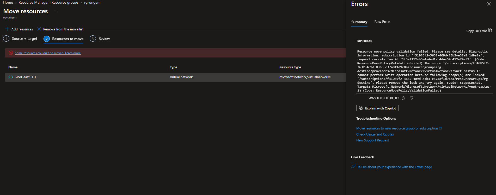

---

## Tarefa 4 — Limpeza e desalocação (Cleanup & FinOps)

### Etapa 17 — Remover o lock do `rg-destino`

Em `rg-destino` → **Locks**, o lock `ReadOnly` foi excluído. O painel passa a exibir ***"This resource has no locks"***. Sem isso, não seria possível desligar a VM nem apagar o RG.

**Evidência:** `images/17-rg-destino-lock-removido-cleanup.png`

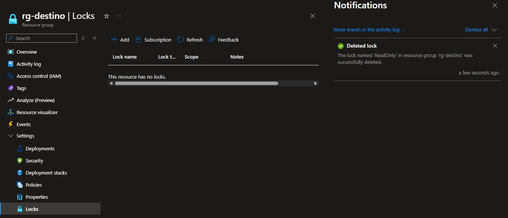

### Etapa 18 — Desligar/desalocar a VM e excluir os Resource Groups

Sem o lock, a VM foi parada com sucesso e ficou em **`Stopped (deallocated)`** (a cobrança de computação cessa). Depois, os Resource Groups foram **excluídos** para **zerar os custos**.

**Evidência:** `images/18-vm-stopped-deallocated-apos-remover-lock.png`

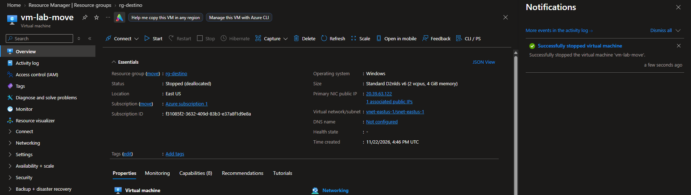

---

## 7\. Tabela comparativa: Lock Delete vs Lock Read-only

Comportamento **prático observado** neste laboratório:

| Operação | Lock `Delete` (`CanNotDelete`) | Lock `Read-only` (`ReadOnly`) |
| :---- | :---- | :---- |
| **Excluir o recurso/RG** | ❌ Bloqueado (`09`) | ❌ Bloqueado |
| **Mover recurso (Move)** | ✅ Permitido (`10`) | ❌ Bloqueado (`12` e `16`) — `ScopeLocked` |
| **Parar/Iniciar/Reiniciar VM** | ✅ Permitido¹ | ❌ Bloqueado (`14`) — `ScopeLocked` |
| **Listar Access Keys (Storage)** | ✅ Permitido¹ | ❌ Bloqueado (`15`) — `409 ScopeLocked` |
| **Alterar configurações (PUT/PATCH)** | ✅ Permitido | ❌ Bloqueado |
| **Herança aos recursos filhos** | ✅ Sim (`08`) | ✅ Sim |
| **Efeito prático** | Proteção contra exclusão acidental | Congela o ambiente (somente leitura) |

¹ Comportamento esperado para o lock `Delete` (que só impede exclusão); **não foi testado explicitamente** neste lab.

---

## 8\. Percepções técnicas e lições aprendidas

1. **Plano de controle ≠ plano de dados.** Mover recursos altera apenas **metadados de agrupamento no ARM**. A `vm-lab-move` e a conexão RDP permaneceram ativas, sem queda, durante toda a transferência (`05`).  
2. **Desacoplamento entre NIC e VNet.** Manter a `vnet-eastus-1` no `rg-origem` enquanto a VM e a NIC (`vm-lab-move231`) foram para o `rg-destino` mostrou que computação e rede virtual **não precisam estar no mesmo RG**, desde que compartilhem a **mesma assinatura e região** (`East US`).  
3. **Diferença crítica entre os locks.**  
   - **`Delete` (`CanNotDelete`)** bloqueia apenas exclusões, e, nos testes, **não impediu a movimentação** do recurso (que perde a herança do lock do grupo antigo).  
   - **`Read-only` (`ReadOnly`)** bloqueia **qualquer escrita** (`PUT`/`POST`/`PATCH`/`DELETE`): impede Move, mudanças de energia da VM (`Start`/`Stop`/`Restart`) e até a visualização de **Access Keys**, pois `listKeys` usa `POST` e gera erro `409 ScopeLocked`.  
4. **Origem vs. destino com lock `Read-only`:**  
   - Lock no **RG de origem** → o ARM rejeita em **menos de 5 segundos**, na primeira barreira (*pre-flight scope lock check*) — `12`.  
   - Lock **só no RG de destino** → o ARM avança para a validação do provedor de recursos e demora cerca de **40 s a 1 min** antes de retornar `ResourceMovePolicyValidationFailed` / `ScopeLocked` — `16`.  
5. **Remover o lock antes da limpeza.** Sem remover o `Read-only`, não é possível nem parar a VM nem excluir o RG. Em ambientes reais, **documente quem pode remover locks**.  
6. **FinOps:** o custo da VM só cessa em **Stopped (deallocated)** ou com a **exclusão** do recurso.

---

## 9\. Problemas comuns e solução de problemas

| Sintoma | Causa provável | Solução |
| :---- | :---- | :---- |
| `ScopeLocked` ao mover, parar VM ou listar chaves | Lock `Read-only` no recurso ou em um RG pai | Remover o lock em **Settings → Locks** (exige Owner/User Access Administrator) e repetir |
| Botões *Edit/Delete* do lock desabilitados em um recurso | O lock é **herdado** do RG | Remover o lock no escopo **onde foi criado**, não no recurso filho |
| `ResourceMovePolicyValidationFailed` | Algum recurso a mover ou o destino viola uma regra (lock, dependência) | Ler os detalhes do erro; verificar locks nos dois escopos |
| Validação do Move falha para a VM | Faltam recursos dependentes na lista | Incluir **NIC, disco, IP e NSG** juntos com a VM |
| RDP não conecta | Porta 3389 bloqueada no NSG ou VM parada | Conferir regra de entrada no NSG e o estado `Running` |
| Erro de cota ao criar a VM | Limite de vCPUs na região | Escolher outro tamanho/região ou pedir aumento de cota |
| `Access keys` retorna `409` | Lock `Read-only` | Remover o lock ou usar identidade/RBAC com autorização via Entra ID |

---

## 10\. Boas práticas

1. Use **locks `Delete`** em recursos críticos (produção, redes, cofres) e reserve o `Read-only` para casos específicos, pois ele afeta operações legítimas.  
2. Aplique locks no **RG** para aproveitar a **herança**.  
3. Sempre inclua uma **nota** descritiva no lock (quem criou e por quê).  
4. Combine locks com **RBAC** e **Azure Policy** (defesa em camadas).  
5. Em um Move, valide **todos os dependentes** e planeje o impacto em scripts/automações que usam o ID do recurso (o ID muda com o RG).  
6. Use **tags** e convenção de nomes (`rg-origem`, `vm-lab-move`).  
7. Ao final de laboratórios: **desaloque, exclua e confira o Cost Management**.

---

## 11\. Competências demonstradas

- Criação e organização de **Resource Groups** e do ciclo de vida de recursos.  
- **Provisionamento de VM Windows** e validação de acesso por **RDP**.  
- **Movimentação de recursos** entre RGs com a carga em execução e análise de dependências.  
- **Resource Locks** (`CanNotDelete` e `ReadOnly`): criação, herança, testes e remoção.  
- Leitura e interpretação de **erros do ARM** (`ScopeLocked`, `ResourceMovePolicyValidationFailed`, `409`).  
- **FinOps** básico: desalocação e limpeza de recursos.  
- Documentação técnica clara, reproduzível e com evidências.

---

## 12\. Próximos passos (Automação & IaC)

A evolução natural deste laboratório é **repetir tudo por código**, de forma versionada e repetível.

| Ferramenta | O que automatizar | Exemplo |
| :---- | :---- | :---- |
| **Azure CLI** | RGs, locks e Move | `az group create`, `az lock create`, `az resource move` |
| **Azure PowerShell** | O mesmo fluxo em scripts | `New-AzResourceGroup`, `New-AzResourceLock`, `Move-AzResource` |
| **ARM Templates / Bicep** | Implantação declarativa da VM e dos locks | recurso `Microsoft.Authorization/locks` |
| **Terraform** | Infraestrutura como código multi-cloud | `azurerm_resource_group`, `azurerm_management_lock` |

**Exemplos de referência (Azure CLI):**

```sh
# Resource Groups
az group create --name rg-origem  --location eastus
az group create --name rg-destino --location eastus

# Lock Delete e Read-only no RG
az lock create --name Delete   --lock-type CanNotDelete --resource-group rg-origem --notes "Teste"
az lock create --name ReadOnly --lock-type ReadOnly     --resource-group rg-destino --notes "Teste"

# Mover recursos (IDs separados por espaço)
az resource move --destination-group rg-destino --ids <ID_VM> <ID_NIC> <ID_IP> <ID_NSG> <ID_DISCO>

# Remover o lock e limpar
az lock delete --name ReadOnly --resource-group rg-destino
az group delete --name rg-origem  --yes --no-wait
az group delete --name rg-destino --yes --no-wait
```

**Terraform (trecho ilustrativo):**

```hcl
resource "azurerm_management_lock" "rg_origem_delete" {
  name       = "Delete"
  scope      = azurerm_resource_group.origem.id
  lock_level = "CanNotDelete"
  notes      = "Teste"
}
```

&nbsp;

**Evoluções sugeridas:**

- Pipeline **GitHub Actions** que implanta e destrói o ambiente automaticamente.  
- **Azure Policy** que exige lock em RGs de produção.  
- Alertas de **Cost Management** para evitar custos esquecidos.

---

## 13\. Glossário

| Termo | Significado |
| :---- | :---- |
| **ARM** | Azure Resource Manager: camada de gerenciamento do Azure. |
| **Resource Group** | Contêiner lógico de recursos com o mesmo ciclo de vida. |
| **Move** | Operação que troca o RG (ou a assinatura) de um recurso. |
| **Resource Lock** | Trava de proteção em assinatura, RG ou recurso. |
| **CanNotDelete / Delete** | Lock que impede a exclusão. |
| **ReadOnly / Read-only** | Lock que impede qualquer escrita. |
| **ScopeLocked** | Erro retornado quando um lock bloqueia a operação. |
| **Plano de controle** | Operações de gerenciamento via ARM. |
| **Plano de dados** | Uso do recurso em si (ex.: RDP, blobs). |
| **RDP** | Remote Desktop Protocol, para acesso gráfico ao Windows. |
| **NIC / NSG** | Interface de rede / grupo de segurança de rede. |
| **Stopped (deallocated)** | VM parada com recursos de computação liberados (sem cobrança de CPU). |
| **IaC** | Infrastructure as Code (infraestrutura como código). |

---

## 14\. Estrutura do repositório

```
az104-resource-management/
├── README.md
└── images/
    ├── 01-rg-origem-vm-criada.png
    ├── 02-rg-destino-vazio.png
    ├── 03-vm-rodando-rdp-windows11.png
    ├── 04-move-validacao-recursos.png
    ├── 05-move-em-andamento-vm-ativa.png
    ├── 06-rg-destino-recursos-movidos.png
    ├── 07-rg-origem-lock-delete-config.png
    ├── 08-storage-heranca-lock-rg-origem.png
    ├── 09-teste-exclusao-bloqueada-lock.png
    ├── 10-move-storage-com-lock-delete.png
    ├── 11-rg-origem-lock-readonly-config.png
    ├── 12-teste-move-bloqueado-readonly.png
    ├── 13-rg-destino-lock-readonly.png
    ├── 14-teste-vm-stop-bloqueado-readonly.png
    ├── 15-storage-access-keys-bloqueado-readonly.png
    ├── 16-teste-move-bloqueado-destino-readonly.png
    ├── 17-rg-destino-lock-removido-cleanup.png
    └── 18-vm-stopped-deallocated-apos-remover-lock.png
```

---

*Laboratório realizado para estudo da certificação **AZ-104** — Resource Management. Todos os recursos foram excluídos ao final do laboratório.*